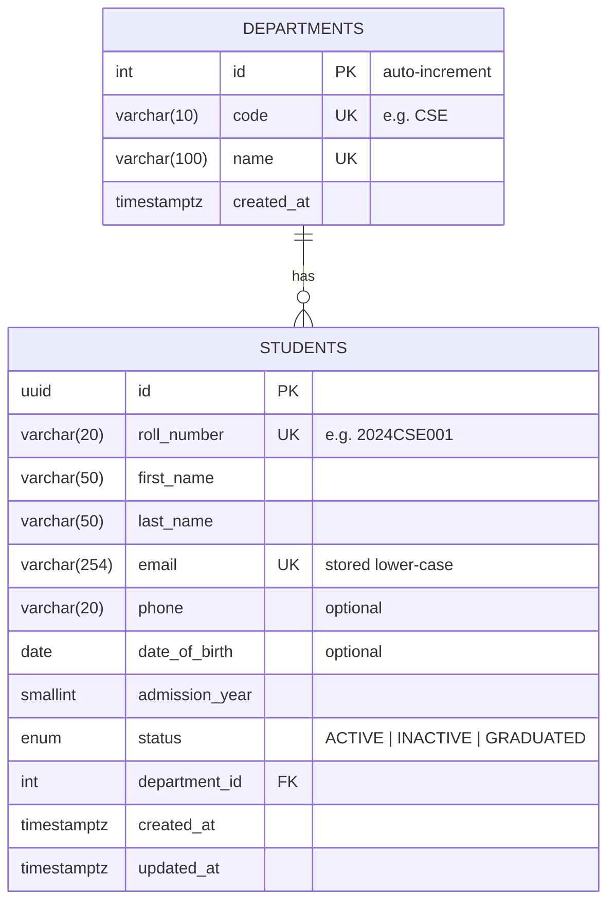

# Student Management System

A web app to **create, update, delete and list** student records, built with **Next.js (App Router), React, TypeScript (strict), Tailwind CSS, PostgreSQL and Prisma**.

The focus is on a well-designed database, clean code structure and solid validation, rather than on feature count.

---

## Features

- **List** students in a sortable, paginated table (10 per page).
- **Search** by name, email or roll number; **filter** by department and status. Filters live in the URL, so every view can be bookmarked or shared.
- **Create** and **edit** students in one shared form, with clear per-field error messages.
- **Delete** with an inline confirmation step.
- Friendly handling of duplicates: "This email is already registered" appears right under the email field.
- A REST API (`/api/students`) that the UI uses, which can also be called directly with `curl` or Postman.

---

## Quick start

**Prerequisites:** Node.js 20.9 or newer, and Docker Desktop (running).

```bash
cp .env.example .env      # Windows PowerShell: copy .env.example .env
npm install               # installs packages and generates the Prisma client
npm run setup             # starts PostgreSQL in Docker, creates tables, loads demo data
npm run dev               # open http://localhost:3000
```

The demo data contains 5 departments and 24 students.

### Scripts

| Command | What it does |
| --- | --- |
| `npm run dev` | Start the app in development mode |
| `npm run build` / `npm start` | Production build / run it |
| `npm run typecheck` | Check all TypeScript types (`tsc --noEmit`) |
| `npm run lint` | Run ESLint |
| `npm run setup` | `db:up` + `db:migrate` + `db:seed` |
| `npm run db:up` / `db:down` | Start / stop the PostgreSQL container |
| `npm run db:migrate` | Apply database migrations |
| `npm run db:seed` | Load demo data (replaces all students) |
| `npm run db:reset` | Drop everything, re-migrate and re-seed |

---

## Database design



### Design decisions

| Decision | Why |
| --- | --- |
| **Departments are a separate table** with a foreign key from students | Avoids the same department spelt three ways ("CSE", "C.S.E", "Comp Sci"). A rename happens in one place, and the UI can list departments in dropdowns. This is standard normalisation (no repeated data). |
| **`ON DELETE RESTRICT`** on the foreign key | A department that still has students cannot be deleted by accident. |
| **UUID primary key for students**, integer for departments | Student ids appear in URLs (`/students/<id>/edit`), and UUIDs can't be guessed or enumerated. Departments are a small internal lookup table, where a simple integer is fine. |
| **`roll_number` separate from `id`** | The roll number is a business identifier and could be corrected; the `id` never changes, so links and references stay valid. |
| **Separate `first_name` / `last_name`** | Allows sorting by last name, and formal or informal display. |
| **`status` as a Postgres enum** | Only the three valid values can ever be stored. |
| **Sized `VARCHAR`s, `SMALLINT`, `DATE`** | Each column uses a type that fits its data: a birth date has no time part, a year fits in a small integer. |
| **`created_at` / `updated_at`** on every row | Basic auditability; `updated_at` is maintained automatically by Prisma. |
| **Unique constraints** on email, roll number, department code and name | Duplicates are impossible even if two requests arrive at the same moment, because the database enforces it rather than a "check first, then insert" in code. |
| **CHECK constraints** (in the migration) | The database itself rejects bad data: roll-number format, lower-case email, non-blank names, plausible admission year and birth date. |
| **Indexes** on `department_id`, `status` and `(last_name, first_name)` | Match the list page's filters and sort order. |

**Two layers of validation:** the app validates every input with zod and returns friendly messages, and the database constraints are a final safety net. The app is the friendly gatekeeper; the database is the guarantee.

**Why the migration has hand-written SQL:** `prisma/schema.prisma` describes tables, columns, relations, unique constraints and indexes, and Prisma generated the SQL for those. Prisma's schema language can't express CHECK constraints, so they're added at the bottom of `migration.sql`, clearly marked.

---

## Code structure

The code is organised in layers. Each layer only talks to the one directly below it:

```
Browser (React components)
   │  fetch("/api/students", ...)
   ▼
API routes          src/app/api/**/route.ts      HTTP in/out: parse + validate request, return JSON
   │
   ▼
Services            src/server/services/*.ts     Business logic; the only code that uses Prisma
   │
   ▼
Prisma Client       src/server/db.ts             Type-safe database access
   │
   ▼
PostgreSQL
```

Pages that only **read** data (the list and edit pages) are server components: they run on the server and call the services directly, so the page arrives already filled in. Components that **change** data (the form and the delete button) run in the browser and call the API.

```
prisma/
  schema.prisma                 Data model: tables, relations, indexes
  migrations/…/migration.sql    SQL that creates the schema (+ CHECK constraints)
  seed.ts                       Demo data
src/
  app/                          Next.js routes: each folder is a URL
    layout.tsx                  Page shell: header + content
    page.tsx                    "/" redirects to /students
    students/page.tsx           /students: list, search, filters, pagination
    students/new/page.tsx       /students/new: add form
    students/[id]/edit/page.tsx /students/:id/edit: edit form
    api/students/route.ts       GET list, POST create
    api/students/[id]/route.ts  GET one, PUT update, DELETE
    api/departments/route.ts    GET departments
    not-found.tsx, error.tsx    404 page and error page
    globals.css                 Tailwind setup + shared styles
  components/                   UI pieces (form, filters, pagination, badges, delete button)
  lib/                          Code shared by browser and server
    validation.ts               zod schemas: one set of rules for form and API
    student-status.ts           Status values and labels
    api-client.ts               Typed fetch() wrapper used by the browser
  server/                       Server-only code
    db.ts                       Prisma client
    errors.ts                   AppError + translation of database errors
    http.ts                     JSON error responses, request-body parsing
    services/                   student-service.ts, department-service.ts
```

---

## API

All responses are JSON. Errors always have the same shape:

```json
{ "error": { "code": "CONFLICT", "message": "A student with this email already exists.",
             "fieldErrors": { "email": ["This email is already registered"] } } }
```

| Method | Path | Description | Success | Errors |
| --- | --- | --- | --- | --- |
| `GET` | `/api/students?search=&departmentId=&status=&page=&pageSize=` | List (paginated) | `200` `{ items, total, page, pageSize, totalPages }` | n/a |
| `POST` | `/api/students` | Create | `201` `{ student }` | `400` invalid, `409` duplicate |
| `GET` | `/api/students/:id` | Get one | `200` `{ student }` | `404` |
| `PUT` | `/api/students/:id` | Update (full replace) | `200` `{ student }` | `400`, `404`, `409` |
| `DELETE` | `/api/students/:id` | Delete | `204` | `404` |
| `GET` | `/api/departments` | List departments | `200` `{ departments }` | n/a |

Example:

```bash
curl -X POST http://localhost:3000/api/students \
  -H "Content-Type: application/json" \
  -d '{"rollNumber":"2026CSE010","firstName":"Asha","lastName":"Rao","email":"asha@example.edu",
       "admissionYear":2026,"departmentId":1,"status":"ACTIVE"}'
```

---

## Possible next steps

- Authentication and roles (admin vs read-only).
- Soft delete (`deleted_at`) if records must be kept for audit.
- CRUD screens for departments.
- CSV import and export.
- A trigram index (`pg_trgm`) to keep search fast with very large numbers of students.

---

## AI tooling

Built with an AI coding assistant, as encouraged by the brief. [`CLAUDE.md`](./CLAUDE.md) contains the context directives the assistant followed; [`AI_PROMPTS.md`](./AI_PROMPTS.md) records the prompts used and how the output was verified.
